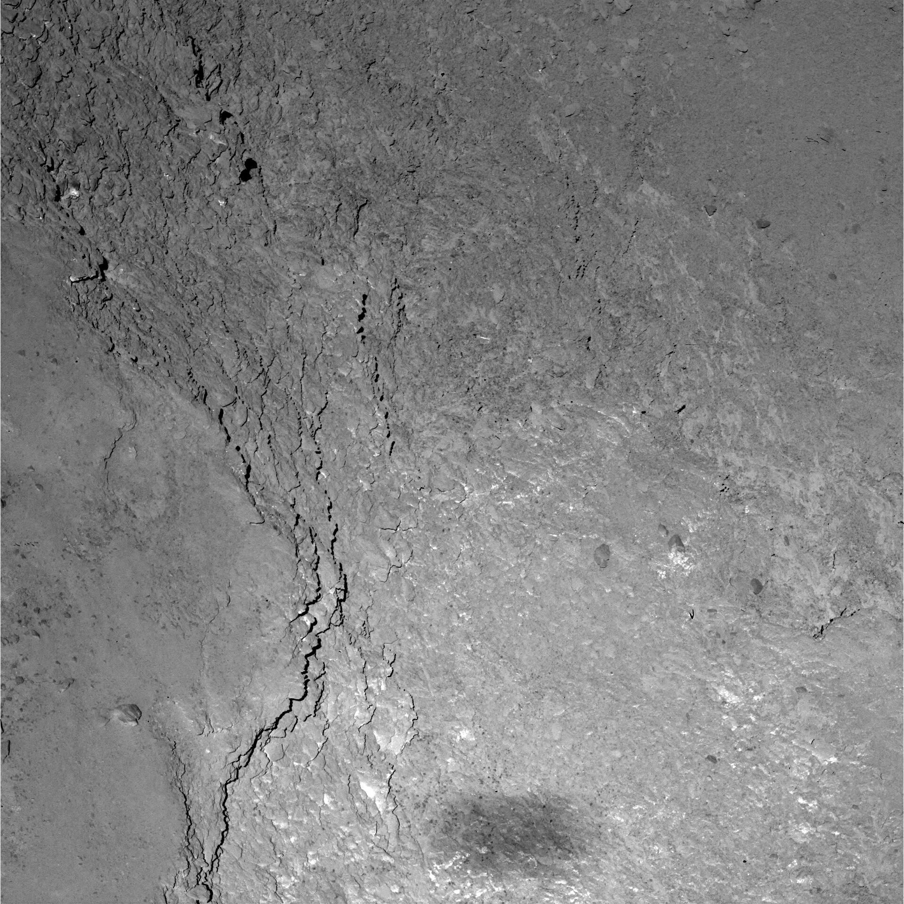
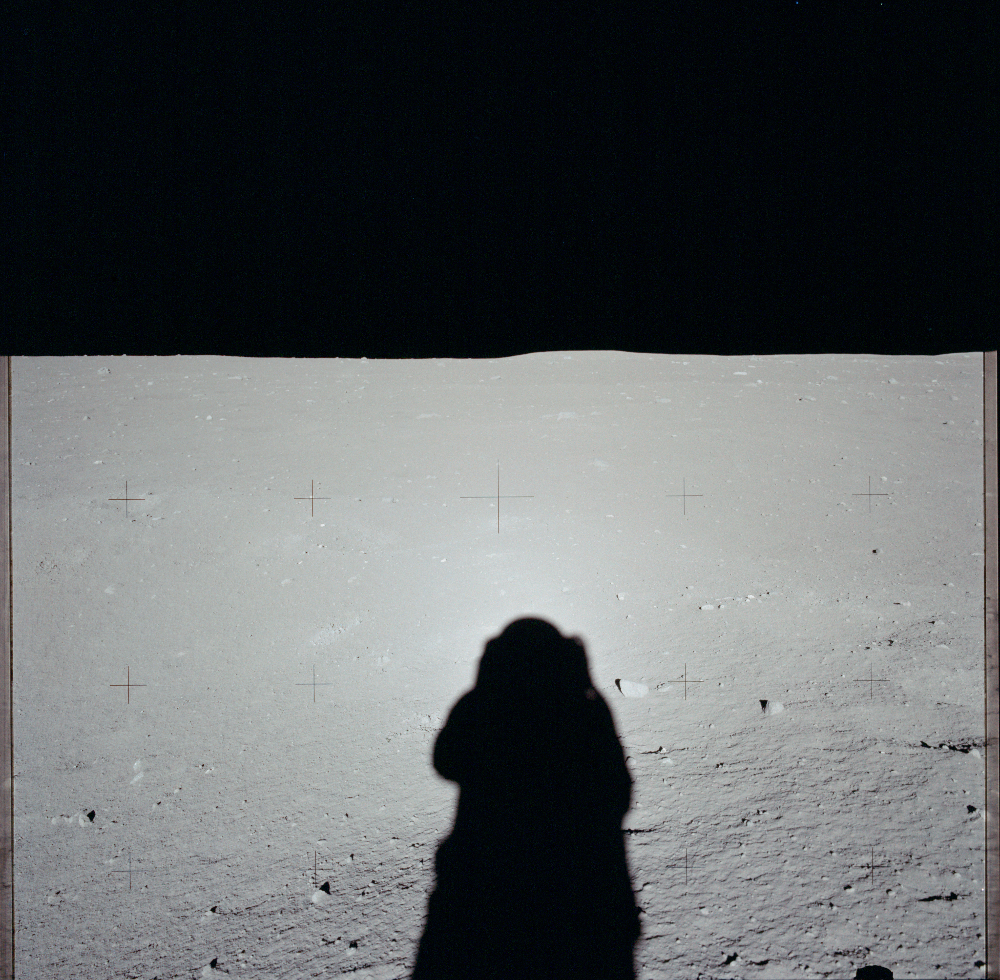

# Phase Function and Absolute Magnitude

## Background

In the previous exercise, we computed the orbit of an unknown asteroid by measuring its motion across the sky. Combining the measured brightness of an asteroid with the known observing geometry of each measurement (as determined by computing its orbit), we can now use evaluate an asteroid’s phase function and determine its absolute magnitude and estimate its size.

In this exercise, we will use data from ATLAS and/or the Zwicky Transient Facility (ZTF), located at Palomar Mountain in the USA. Both survey the sky at optical wavelengths to detecting variable objects. Each dataset contains the data of the observation, the brightness of the asteroid in magnitudes, the error on the brightness measurement, the heliocentric distance (r) and observer distance (δ) of the asteroid in astronomical units (au), and the phase angle ($\alpha$) of the observation in degrees. Recall that the phase angle measures the angle between the sun, object, and observer. These geometric quantities can be computed from the orbital elements you derived in the previous exercise, but in practice, this requires a fair bit of numerical integration—no need to do that by hand! 

## Instructions

1. Using the provided dataset, compute the reduced magnitude $H$ for each observation. Recall the reduced magnitude of an asteroid is its measured magnitude $m$ corrected for distance, or in other words, its predicted magnitude at a distance 1 AU from the Sun and the observer. Create a plot of the measured reduced magnitude $H(\alpha)$ as a function of phase angle $\alpha$. 

$$H = m – 5 \log10\left(\frac{r \delta}{\text{AU}^2}\right)$$

2. The reduced magnitude can also be expressed as a function of absolute magnitude and phase angle using the $H, G$ system. Build an intuition for the meaning of $H$ and $G$ by computing and plotting $H(\alpha)$ as a function of phase angle $\alpha$ for a range of different values of $H$ and $G$ (hint: a typical value of $G$ is 0.15). Use the following empirical form of the $H, G$ phase function:

$$H(\alpha) = H - 2.5 \log10 \left( (1-G)\phi_1(\alpha) + G\phi_2(\alpha) \right)$$
$$\phi_i = \exp \left( -A_i (\tan(\alpha/2))^{B_i} \right) \text{ for } i = 1, 2$$
$$A_1 = 3.33, B_1 = 0.63, A_2 = 1.87,  B_2 = 1.22$$

3. Find the combination of $H, G$ that best fits your dataset (consider using curve fitting algorithms such as `scipy.optimize.curvefit` in Python or similar routines in a program of your choice if you have some experience with coding). Report the best fit values of $H$ and $G$, and produce a plot comparing the observed reduced magnitude $H(\alpha)$ to the reduced magnitude $H(\alpha)$ predicted by the best fit $H, G$ model you found. How well constrained are each of the parameters? What new data and/or changes to the model would you need to reduce the errors in your estimated parameters?
4. Construct a geometric argument to compute the fraction of outgoing sunlight intercepted and reflected by a (spherical) asteroid of diameter $D$ and visible geometric albedo $p_v$ at 1 AU from the Sun. Use the definition of magnitude to derive an expression for the diameter of an asteroid as a function of albedo, the absolute magnitude of the asteroid, and the absolute magnitude of the Sun.
5. Given the absolute magnitude of the Sun is the visible is -26.8, estimate the photometric diameter $D$ of your asteroid based on the value of $H$ you derived for a range of reasonable asteroid albedos.

## Discussion Questions

1. Describe how the appearance of the Moon changes as a function of phase angle to an earth-bound observer. Generalize the concept of lunar phases to other planetary bodies. Which objects can be seen at very high phase angles from Earth? Which objects can never be seen at very high phase angles from Earth?
2. Examine several images taken at very low phase angles on various planetary bodies (see below). Where is the Sun located relative to the observer in these images and how can you tell? At which part of the image is the phase angle the lowest? How does the brightness of the surface change as as a function of phase angle for very low phase angles? What is a physical reason why this effect (called opposition surge) occurs? Have you ever observed it yourself in everyday life?
    - **Comet 67P/C-G on 14 February 2015 - OSIRIS-NAC close up view**, reproduced under the ESA common license for educational purposes. Credits: ESA/Rosetta/MPS for OSIRIS Team MPS/UPD/LAM/IAA/SSO/INTA/UPM/DASP/IDA [(original)](https://sci.esa.int/web/rosetta/-/55516-comet-67p-on-14-february-2015-osiris-nac-close-up-image) 
    - **Mars2020 - Sol 772 - Ingenuity Color Camera**, repoduced under [Creative Commons Attribution License 2.0 Generic License](https://creativecommons.org/licenses/by/2.0/deed.en). Credits: NASA/JPL-Caltech/Kevin M. Gill [(original)](https://www.flickr.com/photos/kevinmgill/52842811716/) 
    - **AS11-40-5882 - Apollo 11 - Apollo 11 Mission image - Lunar surface and horizon with astronaut shadow in foreground**, public domain image. Credits: NASA [(original)](https://catalog.archives.gov/id/16685073) 
3. Research alternative formulations to the $H, G$ phase function used here, such as the $HG_1G_2$, $HG_{12}$, and shape-corrected phase functions. What specific research challenges are each of these models attempting to address? What are the advantages of using one model over another? How would you choose which model to use in a particular research situation? Sources for getting started:
    - [A three-parameter magnitude phase function for asteroids](https://doi.org/10.1016/j.icarus.2010.04.003)
    - [H, G1, G2 photometric phase function extended to low-accuracy data](https://doi.org/10.1016/j.pss.2015.08.010)
    - [Combined spin orientation and phase function of asteroids](https://doi.org/10.1051/0004-6361/202449789)
    - [Asteroid phase curve modeling with empirical correction for shape and viewing geometry](https://doi.org/10.1016/j.icarus.2025.116886)

