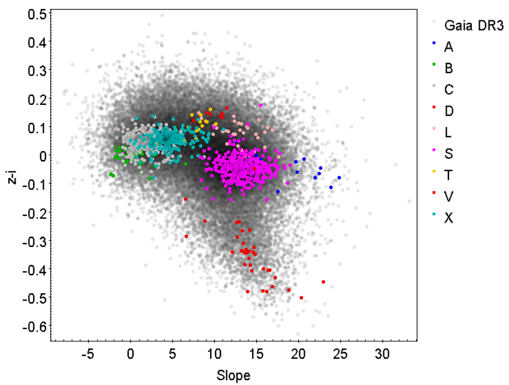

# Spectroscopy

## Background

In this exercise, we will use data from the Gaia mission. Gaia is an ESA space-based observatory with the primary goal of precisely measuring the positions and obtaining the visible-light spectra of billions of stars in our galaxy. Over the course of its mission, Gaia also observed and obtained visible-light spectra of numerous Solar System objects including many asteroids. Each dataset contains sixteen datapoints, each with a corresponding wavelength, a flux measurement at that wavelength, an error on the flux measurement, and a ‘flag’ indicating data points that may have quality issues (in this case, zero means the data is of good quality). 

## Instructions

1. At visible wavelengths, the flux received by Gaia from an asteroid is dominated by reflected light from the Sun. Therefore, in terms of raw flux, asteroid spectra are all quite similar to the instrument’s response to a solar spectra, with minor variations therein. To measure the true color of an asteroid (and to make more visible the differences between the spectra of different asteroids), astronomers examine visible asteroid spectra in terms of reflectance. Included in the provided datasets is a composite spectrum of Gaia’s instrumental response to a collection of observed solar-like stars. Use it to convert the flux measurements of the asteroid to reflectance and plot the resulting reflectance spectrum.
2. Compare your derived reflectance spectrum to the average spectra of the [Bus-DeMeo taxonomic types](10.1016/j.icarus.2009.02.005) (see attached datasets, derived from data available at the [NASA Planetary Data System Small Bodies Node](https://sbn.psi.edu/pds/resource/busdemeotax.html)). Which taxonomic type(s) most closely match the spectrum of your asteroid? If multiple taxonomic types are good fits, what additional information could you collect in order to distinguish which type is a better fit? 
3. Previous studies of the asteroid population in the visible have demonstrated that asteroids of different spectral types can be distinguished by measuring their visible spectral slopes and the strengths of their 1-micron absorption feature. Determine the spectral slope of your asteroid by fitting a straight line to all reflectance measurements between 450 and 760 nm and flag = 0. For line $L(x)$, the spectral slope in %/100 nm is given by:  
$$S = \frac{(L(650 \text{nm}) - L(550 \text{nm}))}{L(550 \text{nm})} * 100$$
Next, quantify the strength of the 1 micron absorption feature by estimating the asteroid’s (z-i) color, which can be computed using     
$$z − i = 2.5 \log10 \left(\frac{Rz}{Ri}\right)$$
where Rz and Ri represent the interpolated values of the reflectances at 748 nm and 893 nm, respectively. Report S and (z-i) for your asteroid. Compare these values to Fig. 9 of [Gaia Data Release 3: Reflectance spectra of Solar System small bodies](https://doi.org/10.1051/0004-6361/202243791). Where does your asteroid fall on this plot? What taxonomic types are near to it in (z-i) vs. S space? 

    **Gaia DR3 asteroid taxonomy.** reproduced under the [Creative Commons 4.0 license](https://creativecommons.org/licenses/by/4.0/). Credits: Gaia Collaboration et al. 

4. Given your results in parts 2 & 3, how would you classify your asteroid? What are the likely implications for the composition based on this taxonomic assignment? What minerals might be present on the surface, and how do they show up in your asteroid’s spectrum?
5. Read [Solar System evolution from compositional mapping of the asteroid belt](https://doi.org/10.1038/nature12908). Describe the general trends observed in asteroid composition as a function of heliocentric distance and asteroid diameter. Given the orbit, size, and taxonomic type you previously determined for your asteroid, is your asteroid a representative or an unusual member of its group?

## Discussion Questions

1. Given thousands of asteroid spectra, how would you decide which spectral features are the most important to form the basis of a taxonomic system? What computational tools would you use? How would you decide how many taxonomic types you would need and where the boundaries between them are?
2. Research other taxonomic systems for classifying small bodies (asteroids, TNOs, etc.) based on their spectral appearances. For which populations are these taxonomies relevant? For each taxonomy, information from which spectral regions is needed to perform the classification? 
